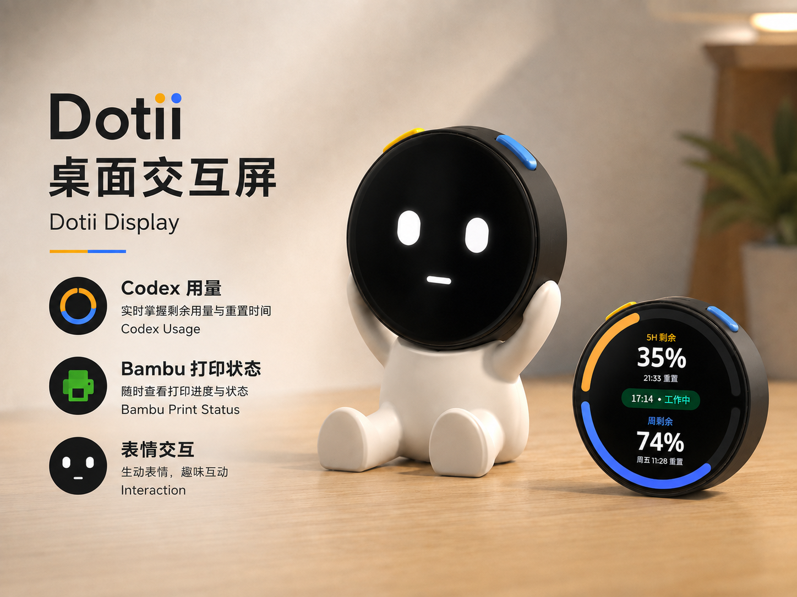

# Dotii 桌面交互屏

**简体中文** | [English](README.en.md)

Dotii 是一套由 ESP32-S3 圆形 AMOLED 桌面屏与 Windows/macOS 端“Dotii 管理中心”组成的开源状态显示系统，用于显示 Codex 用量与任务状态、Bambu Lab 打印进度、自定义内容和互动表情。



[Windows 下载](https://github.com/ZeroOne000011/Dotii-Display/releases/tag/v1.2) · [macOS 下载（预览版）](https://github.com/ZeroOne000011/Dotii-Display/releases/tag/v1.2-macos-preview.1) · [MakerWorld 模型与装配资料](https://makerworld.com.cn/zh/models/2918764-dotii-zhuo-mian-jiao-hu-ping#profileId-3421401) · [开发指南](开发指南.md)

## 下载与支持范围

当前版本为 **1.2**。两个平台共用同一套设备固件，安装包均已包含运行所需组件，无需另行安装 Python、Node.js、Codex CLI、FFmpeg 或 ESP-IDF。

| 系统 | 支持范围 | 下载文件 | 发行类型 |
| --- | --- | --- | --- |
| Windows | Windows 10/11 x64 | `DotiiManagementCenter-1.2-portable.zip` | 正式版 |
| macOS | Apple Silicon、macOS 13.5 及以上 | `DotiiManagementCenter-macOS-arm64-1.2.dmg` | 预览版，ad-hoc 签名，未经苹果公证 |

Mac 预览版不支持 Intel。目前在一台运行 macOS 27.0.1 的 Apple Silicon Mac 上验证；13.5 是构建声明的最低版本，尚未在该系统或另一台 Mac 上实测。真实注销/登录后的自动启动、Mac 睡眠恢复及全新权限环境仍待验证。

## 使用前准备

| 类别 | 项目 | 数量 | 购买/资料链接 |
| --- | --- | ---: | --- |
| 核心硬件 | 微雪 Waveshare ESP32-S3-Touch-AMOLED-1.75 开发板（含 1.75 英寸圆形屏，无外壳） | ×1 | [淘宝](https://e.tb.cn/h.8msjONXF0M0Vdg1?tk=X4anTUTbPSP) · [官方文档](https://docs.waveshare.net/ESP32-S3-Touch-AMOLED-1.75/) |
| 供电 | 3.7 V、400 mAh 602030 锂电池，带 **MX1.25 2P 插头** | ×1 | [拼多多](https://mobile.yangkeduo.com/goods.html?ps=nMO2vEcuRY) |
| 结构配件 | Type-C 弯公头转母头，用于底座内的接口引出 | ×1 | [拼多多](https://mobile.yangkeduo.com/goods.html?ps=m4Bzx5p2iF) |
| 紧固件 | M2 螺丝，长度 4–7 mm | ×3 | — |
| 3D 打印件 | 外壳、底座、按钮等结构件 | ×5 | [模型、打印文件和装配资料](https://makerworld.com.cn/zh/models/2918764-dotii-zhuo-mian-jiao-hu-ping#profileId-3421401) |
| 连接与网络 | 支持数据传输的 USB 线；使用 Wi-Fi 时需 2.4 GHz 网络 | 各 ×1 | — |

## 安装与首次连接

### Windows

1. 下载 Windows ZIP，完整解压到一个新文件夹，运行 `DotiiManagementCenter.exe`。
2. 程序会驻留在系统托盘，并打开管理网页；也可访问 `http://127.0.0.1:8787`。
3. 按下方“连接 Dotii”完成设备设置。

保持解压目录结构不变，不要单独移动或运行 `DotiiBridge.exe`。关闭浏览器不会退出管理中心，请通过托盘图标打开页面、查看日志或退出。

### macOS

1. 下载 DMG，打开后将 `DotiiManagementCenter-1.2.app` 拖到“应用程序”。
2. 打开应用。如果系统阻止启动，在“系统设置 → 隐私与安全性”中选择“仍要打开”并确认。无需全局关闭系统安全检查；受管理的 Mac 可能禁止运行未经公证的应用。
3. 按系统提示允许蓝牙和本地网络访问。应用驻留在菜单栏，通过图标打开管理网页、查看日志或退出。
4. 按下方步骤完成设备设置。

### 连接 Dotii

1. 用支持数据传输的 USB 线连接设备，在管理中心“设置”页面识别 Dotii。首次使用时，可通过“一键烧录”写入随包固件。
2. 选择“自动（USB 优先）”“仅 USB”或“仅 Wi-Fi”。使用 Wi-Fi 时，通过 USB 或蓝牙同步 2.4 GHz Wi-Fi 与管理中心连接信息；仅 USB 同步无需连接路由器。
3. 在“设置 → Dotii 管理中心 → 应用设置 → 语言/Language”切换中英文，管理中心和圆屏同步切换；任务文字、文件名和自定义内容保留原文。
4. 按需启用 Codex 或 Bambu，并完成对应配置。两个模块首次运行默认关闭，启用前不会自动安装、登录或连接外部服务。

## 主要功能

- **Codex 状态**：显示官方接口提供的额度、用量、任务状态、计划进度和用户可见消息；缺失数据显示 `--`。近 7 日 Token 按数量使用整数或 `k/m/b` 单位。
- **Bambu 打印状态**：通过局域网读取进度、温度、耗材和图层，并在打印机支持时显示相机画面。管理中心和设备详情页均仅展示信息，打印操作请使用打印机或 Bambu 官方应用。
- **自定义页面**：编辑文字、颜色、图片和圆环，并同步到 466 × 466 圆屏。
- **Dotii 表情**：显示待机、眨眼、连接、工作、完成、失败等动画，可配置业务状态与表情的映射和持续时间。
- **设备管理**：USB/蓝牙配网、USB/Wi-Fi 同步、显示与休眠设置、重置配网、登录自启动及受保护的一键烧录。

## 更新、校验与卸载

更新前先从托盘或菜单栏退出旧版管理中心。

| 操作 | Windows | macOS |
| --- | --- | --- |
| 更新 | 新版 ZIP 完整解压到新的空文件夹；确认正常后删除旧程序目录，避免直接覆盖 | 用新版 App 替换“应用程序”中的旧版 |
| 配置目录 | `%LOCALAPPDATA%\StateDisplay` | `~/Library/Application Support/Dotii` |
| 卸载 | 退出后删除程序目录 | 退出后将 App 移到废纸篓 |

替换或删除程序不会清除上述配置；需要完全卸载时再手动删除配置目录。配置可能包含 Bambu 访问码和设备连接信息，请勿上传或分享。

版本包含设备功能更新时，使用新版管理中心的一键烧录；常规烧录保留 NVS 配置。更换电脑系统无需重复烧录同一版本固件。

Windows：在 ZIP 所在目录计算哈希，与同一 Release 的 `SHA256SUMS.txt` 比较：

```powershell
Get-FileHash .\DotiiManagementCenter-1.2-portable.zip -Algorithm SHA256
```

macOS：将 DMG 与同名 `.dmg.sha256` 放在同一目录，进入该目录执行，结果应为 `OK`：

```bash
shasum -a 256 -c DotiiManagementCenter-macOS-arm64-1.2.dmg.sha256
```

校验不一致时请重新下载，不使用该文件。

## 常见问题

大多数软件问题可以借助 Codex 等 AI 工具排查和解决；增加新功能时也可以借助 AI 完成开发。

<details>
<summary><strong>管理页面没有打开</strong></summary>

确认管理中心正在运行，从 Windows 托盘或 Mac 菜单栏图标重新打开；也可访问 `http://127.0.0.1:8787`。

</details>

<details>
<summary><strong>Codex 没有数据</strong></summary>

确认模块已启用，并已在官方 Codex 中登录。在 Codex 设置中运行“Codex 运行检测”，按分项结果排查。接口未提供的数值显示为 `--`。

</details>

<details>
<summary><strong>Bambu 没有打印数据或相机画面</strong></summary>

确认电脑与打印机处于同一局域网，检查打印机 IP、序列号、访问码和局域网模式。相机不可用不会影响打印状态。

</details>

<details>
<summary><strong>找不到 Dotii</strong></summary>

更换支持数据传输的 USB 线并重新扫描。需要下载模式时，按开发板说明使用 BOOT 按键后重试。烧录仅对识别为 Dotii ESP32-S3 的设备开放。Mac 用户还应检查“系统设置 → 隐私与安全性 → 蓝牙”中的授权。

</details>

<details>
<summary><strong>更换电脑、路由器或重置后无法连接</strong></summary>

长按 Dotii 右侧按钮进入“设置”，长按“重置配网”1.2 秒，设备会清除 Wi-Fi、管理中心绑定和蓝牙配对并重启。随后在新电脑重新扫描配网；语言、方向和休眠设置保留。

若电脑仍保留旧配对，Windows 会尝试自动恢复一次；Mac 请在“系统设置 → 蓝牙”中忽略 Dotii 后重新扫描。电脑局域网 IP 变化时也可能需要重新同步管理中心地址。

</details>

<details>
<summary><strong>如何查找日志</strong></summary>

通过托盘或菜单栏查看日志，或在上述配置目录中查找 `bridge.log`。分享前请检查并移除不希望公开的本机信息。

</details>

## 数据与安全

管理网页和管理 API 仅允许本机访问，设备读取数据需要访问令牌。Wi-Fi 密码、Bambu 访问码和设备令牌保存在本机配置中，不应进入公开仓库。烧录只允许已识别的设备和有效固件包。

Windows 首次允许局域网访问时可能显示防火墙窗口，程序名称应为“Dotii 管理中心后台服务”，请按实际使用的网络类型授权。

历史上曾出现偶发睡眠恢复复位和蓝牙广播暂时不可见，后续回归未复现，根因仍未确认；遇到类似问题请保留复现步骤和日志。

## 开发与二次开发

请阅读[开发指南](开发指南.md)，按需要查看[架构与源码](开发指南.md#architecture)、[模块扩展](开发指南.md#modules)、[测试与调试](开发指南.md#validation)、[Windows 构建](开发指南.md#windows-development)或 [macOS 构建](开发指南.md#macos-development)。

## 社区贡献与扩展

感谢社区开发者为 Dotii 提供功能扩展。以下贡献尚未合并，不属于当前发布版本。

### Z.ai 用量与 Claude Code 工作状态模块

[@wfzylcl878-creator](https://github.com/wfzylcl878-creator) 提供了 Z.ai 的 GLM Coding Plan 用量显示、通过 hooks 获取 Claude Code 工作状态及表情联动，并包含模块状态、代理 fake-ip 地址过滤等改进。

维护者目前缺少独立验证条件，暂不合并，仅提供参考。贡献者报告已完成 macOS 源码测试、固件构建和真机验证，Windows 尚未实测。

[PR #1](https://github.com/ZeroOne000011/Dotii-Display/pull/1) · [贡献者仓库](https://github.com/wfzylcl878-creator/Dotii-Display) · [PR 对应实现版本](https://github.com/wfzylcl878-creator/Dotii-Display/tree/529d962aefd3747fc671c16152a1a4df79ec12cb)
